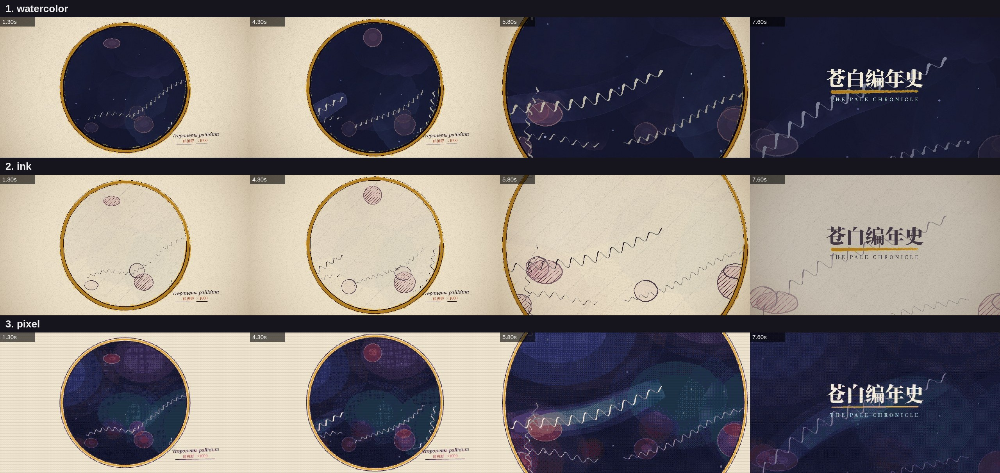

# claude-video-studio

Code-drawn animation for short films: scenes are written once in JavaScript and rendered frame by frame in
headless Chrome in a chosen **style** — watercolor, pen & ink, or pixel art — then cut together with sound and
subtitles by ffmpeg. Built to be driven by Claude (see the `video-studio` skill), usable by hand.


*The same 8-second shot (`examples/spirochete`) in the three styles.*

## Layout

| path | what |
|---|---|
| `engine/core.js` | style-agnostic core: timing, easing, camera, shots, plates, drawing API |
| `engine/styles/` | `watercolor.js` (p5.brush), `ink.js` (pen & hatching), `pixel.js` (Canvas2D, palette-snapped) |
| `engine/studio.html` | the page every frame is painted in (`?project=<dir>&style=<name>`; open it in a browser to scrub) |
| `tools/render.mjs` | contact sheets, style boards, frames → MP4 (GPU Chrome via puppeteer-core, or Playwright) |
| `tools/sfx.py` | sound design from a JSON cue sheet (drones, heartbeat, whoosh, riser, boom, bell…) |
| `tools/assemble.py` | final cut from a JSON edit list: clips, crossfades, narration, ducked music, subtitles |
| `tools/render_film.bat` | Windows double-click: render every shot of a film |
| `examples/spirochete` | 8 s example shot |
| `docs/ENGINE.md`, `docs/STYLES.md` | API reference, style guide, how to add a style |

## Quick start

```bash
cd tools && npm install && cd ..                      # puppeteer-core + ffmpeg-static (needs Chrome or Edge installed)
node tools/render.mjs --project=examples/spirochete --board=1.3,4.3,7.6 --styles=watercolor,ink,pixel
node tools/render.mjs --project=examples/spirochete --style=watercolor --all
python tools/sfx.py examples/spirochete/cues.json examples/spirochete/sound.wav   # numpy + scipy
```

A GPU makes a huge difference for watercolor/ink (RTX 3060 Ti ≈ 0.1 s per 1080p frame vs ≈ 10 s in software).
Add `--soft` on machines without a GPU. Pixel style needs no GPU.

## Credits

Inspired by [JohnHeibel/PDoomVideo](https://github.com/JohnHeibel/PDoomVideo), a music video painted entirely in code by Claude.
Uses [p5.js](https://p5js.org) (LGPL-2.1) and [p5.brush](https://github.com/acamposuribe/p5.brush) (MIT, see `engine/vendor/`).
